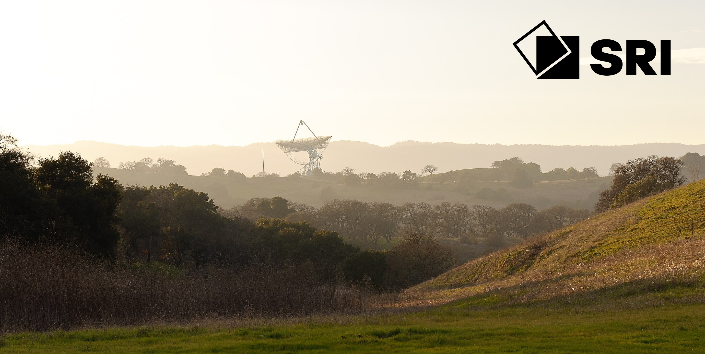

# Formal Methods Program

The Formal Methods group of SRI's Computer Science Lab (CSL) is a leader in the founding, theory, and practice of
formal methods, fault-tolerant computing, and the development of high-assurance software systems.

## Latest News
### 2026
 - [05/2026] [Fifteenth Summer School on Formal Techniques](https://ssft-sri.github.io/) @ Menlo College
<!-- - [03/2026] Formal methods tool licenses have been updated from [GPL](https://www.gnu.org/licenses/gpl-3.0.en.html) to [MIT](https://opensource.org/license/mit)! 
 - [02/2026] PVS 8.0 released! See the updated release @ [PVS's GitHub repository](https://www.github.com/SRI-CSL/PVS). 
 - [02/2026] Yices 2.7.1 released! See the updated release @ [Yices2's GitHub repository](https://www.github.com/SRI-CSL/Yices2).
 - [02/2026] SAL 3.4 released! See the updated release @ [SAL's new GitHub repository](https://www.github.com/SRI-CSL/SAL).
-->
### 2025
 - [08/2025] SMT-COMP 2025: Yices2 wins in the categories of quantifier-free bitvectors, uninterpreted functions, linear and nonlinear real and integer arithmetic! See the [SMT-COMP results](https://smt-comp.github.io/2025/results/).
 - [07/2025] Yices 2.7.0 released! See the updated release @ [Yices2's GitHub repository](https://www.github.com/SRI-CSL/Yices2).
 - [06/2025] Yices2 submitted to SMT-COMP 2025!
 - [06/2025] [PVS Day @ NASA Formal Methods 2025](https://shemesh.larc.nasa.gov/nfm2025/pvs-day.html)
 - [05/2025] [Fourteenth Summer School on Formal Techniques](https://ssft-sri.github.io/old/2025) @ Menlo College
 - [05/2025] _Boosting MCSat Modulo Nonlinear Integer Arithmetic via Local Search_ accepted to CADE-30!
 - [04/2025] _Decision Heuristics in MCSat_ accepted to CAV 2025!
 - [11/2024] SRI has been awarded a contract by ARPA-H (under the PARADIGM effort) to develop a mobile healthcare platform that improves  healthcare access and health outcomes across rural America.
 
